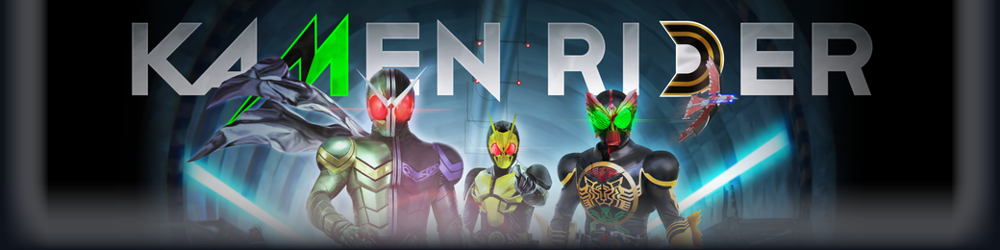

# Kamen Rider: Memory of Heroes (Port Android ARM64, Edisi `nixport`)

<p align="center">
  <a href="README.md">English</a> | <strong>Bahasa Indonesia</strong>
</p>

<p align="center">
  
</p>

<p align="center">
  
  
  
  
  
</p>

---

## Edisi Tersedia (PC & Android)

| Platform | Repository | Keterangan |
| :--- | :--- | :--- |
| **Android ARM64 (`nixport`)** | [ao-zero/Kamen-Rider-Memory-of-Heroes-Android](https://github.com/ao-zero/Kamen-Rider-Memory-of-Heroes-Android) *(Repo Ini)* | Port Android ARM64 (`FEXCore` + `shadPS4`, `v1.0.0`) |
| **Windows PC (x64)** | [ao-zero/Kamen-Rider-Memory-of-Heroes-PC](https://github.com/ao-zero/Kamen-Rider-Memory-of-Heroes-PC) | Versi PC Native (`v1.2.0`, 60 FPS, Clean UI) |

---

## Ringkasan Proyek

**Kamen Rider: Memory of Heroes (Port Android ARM64, Edisi `nixport`)** adalah proyek launcher dan paket port *open-source* untuk menjalankan **Kamen Rider: Memory of Heroes (`CUSA17374`)** di perangkat Android ARM64 menggunakan **`nixport` + `FEXCore` (CPU guest x86-64 ke ARM64) + `shadPS4` Vulkan 1.3**, lengkap dengan **Built-in Patch Bahasa Indonesia (5.993 baris gaya fansub Bakka Sub)** dan **Touch Virtual Gamepad** bawaan.

Dibangun khusus untuk tiga Rider utama:
- **Kamen Rider Double (W)**: Cyclone & Joker
- **Kamen Rider OOO**: TaToBa (Taka, Tora, Batta)
- **Kamen Rider Zero-One**: Rising Hopper

### Tim & Partner
- **Port Lead & Developer:** **AO Zero**
- **Community Partner & Lokalisasi Bahasa Indonesia:** [**Bakka Sub**](https://www.bakkasub.my.id)

---

## Fitur Utama

- **Clean UI Launcher v1.0.0 (Dark & Light Mode, 5 Bahasa):** Antarmuka bersih yang terinspirasi [XSEmu](https://github.com/zortos293/xsemu) berbasis Pure Python `tkinter` (0 dependensi eksternal) dengan dukungan **5 bahasa** (`ID`, `EN`, `ES`, `PT-BR`, `PT-PT`), otomatis menyesuaikan layar penuh dan skala sentuh saat berjalan di `nixport` (`FEXDROID_PRESENT`).
- **Built-in Patch Bahasa Indonesia (Bakka Sub x AO Zero):**
  - 1-klik aktifkan **5.993 baris terjemahan** Bahasa Indonesia (`help_list`, `menu_text`, `mission_talk`, `name_text`) pada `CUSA17374/Media/sharedassets0.assets`.
  - Pure-Python Unity `2017.4.40f1` patcher dengan **backup vanilla otomatis** di `home/kr_moh/bin/user/vanilla_backup/` agar bisa dikembalikan ke **Original (EN/JP)** kapan saja.
- **Auto-Preset Mobile 1-Klik & Preset Performa (`540p / 720p / 1080p` & `30 / 60 FPS`):**
  - Deteksi otomatis spesifikasi HP (SoC, RAM, penyimpanan, Vulkan Turnip ICD, ukuran Shader Cache) lengkap dengan tombol **Auto-Preset** dan sinkronisasi otomatis `config.json`.
  - Proteksi anti-bentrok input: otomatis memaksa `mouse_to_joystick = none` saat `FEXDROID_PRESENT` aktif agar analog kanan sentuh tidak bentrok dengan pointer.
- **Ekspor ZIP Diagnosa 1-Klik & Update Checker:** Mengemas spesifikasi HP, `launcher.ini`, `config.json`, `session_stats.json`, `launch.log`, dan `shad_log.txt` ke 1 file `.zip` untuk laporan bug, plus cek dan unduh update `.nixport.zip` dari GitHub Releases.
- **Playtime Tracker, Auto-Backup Save & 50 Trophy Bilingual:** Mencatat total jam main & status sesi terakhir, membuat auto-backup save sebelum main (simpan 5 terakhir), mendukung impor save `.zip` aman (anti Zip Slip), serta katalog 50 trophy PS4 resmi.
- **Touch Virtual Gamepad Siap Pakai (`virtualkeys.json`):** Layout landscape khusus pertarungan Kamen Rider (`L1/L2`, `R1/R2`, diamond `△○×□`, Dual Analog, D-Pad, Map, Options) otomatis terpasang saat import paket ke `nixport`.

---

## Spesifikasi Perangkat Android

| Komponen | Minimum (`540p`, `30 FPS`) | Rekomendasi (`720p`, `60 FPS`) |
| :--- | :--- | :--- |
| **OS** | Android 11+ (ARM64 / `aarch64`) | Android 13 / 14 / 15 (ARM64) |
| **Chipset / GPU** | Qualcomm Snapdragon 865 / 870 / 7+ Gen 2 / 8 Gen 1 (Adreno 650 / 7xx) | Qualcomm Snapdragon 8 Gen 2 / 8 Gen 3 / 8 Elite (Adreno 740+) |
| **Driver Vulkan** | Vulkan 1.3 via **Mesa Turnip** (diatur di `nixport`) | Mesa Turnip terbaru (Vulkan 1.3 / 1.4) |
| **RAM** | 8 GB | 12 GB atau 16 GB |
| **Penyimpanan Kosong** | 15 GB (internal storage cepat / UFS) | 20 GB+ (UFS 3.1 / 4.0) |
| **Kontrol** | Layar Sentuh (`virtualkeys.json` bawaan) | Gamepad Bluetooth / USB-C (DualSense, Xbox, GameSir, Backbone) |

> **Catatan GPU:** GPU Adreno 5xx lama (seperti Snapdragon 636) dan GPU non-Snapdragon (Mali, Xclipse, PowerVR) tidak didukung karena `shadPS4` membutuhkan ekstensi Vulkan 1.3 lengkap dari driver **Mesa Turnip** (Adreno 6xx/7xx/8xx).

---

## Tutorial Instalasi Step-by-Step (Android)

> **Penting (Legal):** Repository dan file rilis ini **TIDAK** menyertakan file game, ROM, atau `eboot.bin` berhak cipta. Anda harus menggunakan dump legal dari game PS4 *Kamen Rider: Memory of Heroes* (`CUSA17374`) milik Anda sendiri.

### Langkah 1: Install Aplikasi Host `nixport`
1. Unduh APK terbaru **`nixport`** dari [zFitness/nixport Releases](https://github.com/zFitness/nixport/releases).
2. Pasang APK `nixport` di HP Android Anda dan berikan izin akses penyimpanan (*All Files Access*) agar bisa membaca folder game di `/sdcard/`.
3. Buka `nixport`, pastikan rootfs Linux ARM64 dan driver Vulkan **Mesa Turnip** sudah terpasang di pengaturan `nixport`.

### Langkah 2: Unduh & Import Paket Port
1. Unduh **`KamenRiderMoH.nixport.<versi>.zip`** dari halaman [Releases](https://github.com/ao-zero/Kamen-Rider-Memory-of-Heroes-Android/releases).
2. Buka **`nixport`**, masuk ke tab **Library**, lalu pilih **Import Port package**.
3. Pilih file `.zip` tersebut. `nixport` akan otomatis membaca `port.json`, mengekstrak `KamenRiderMoH-arm64.AppImage`, dan mendaftarkan tombol sentuh `virtualkeys.json`.

### Langkah 3: Taruh Dump Game (`CUSA17374`) di Penyimpanan Internal
Salin folder dump game PS4 Anda (disarankan sudah termasuk Update `v1.01`) ke penyimpanan internal, misalnya:
```text
/storage/emulated/0/Games/CUSA17374/
├── eboot.bin                  <-- Wajib ada
├── sce_sys/
│   └── param.sfo
└── Media/
    └── sharedassets0.assets   <-- Target Patch Bahasa Indonesia
```
> Hindari menaruh dump game di SD Card eksternal yang lambat karena akan memicu stutter saat streaming aset Unity.

### Langkah 4: Konfigurasi & Mainkan
1. Di dalam `nixport`, tap **Kamen Rider: Memory of Heroes** lalu buka **KR Memory of Heroes Launcher**.
2. Di tab **Overview**, klik **Pilih** pada baris *Folder* lalu arahkan ke `/storage/emulated/0/Games/CUSA17374`.
3. Sesuaikan **Quick Overrides** dengan spesifikasi HP Anda:
   - **Snapdragon 865 / 870 / 8 Gen 1:** `540p`, `30 FPS` (atau `60 FPS`), FSR `On`.
   - **Snapdragon 8 Gen 2 / 8 Gen 3 / 8 Elite:** `720p`, `60 FPS`.
4. *(Opsional)* Untuk mengaktifkan **Subtitle Bahasa Indonesia (Bakka Sub)**: klik **Patch Indo** di bar atas, atau buka tab **Patch Indo** lalu klik **Aktifkan Patch Bahasa Indonesia**.
5. Tekan tombol biru **Play** untuk mulai bermain.

---

## Layout Kontrol Sentuh & Gamepad (`virtualkeys.json`)

| Tombol / Stick | Posisi Layar (Landscape) | Fungsi dalam Game |
| :--- | :--- | :--- |
| **Left Analog Stick** | Kiri Bawah | Menggerakkan Kamen Rider |
| **D-Pad** | Kiri Tengah-Bawah | Ganti Item / Aksi Menu / Shortcut |
| **Right Analog Stick** | Kanan Bawah-Tengah | Kontrol Kamera 360° |
| **`□` (Square)** | Kanan Bawah (Kiri Diamond) | Light Attack / Serangan Cepat |
| **`△` (Triangle)** | Kanan Bawah (Atas Diamond) | Heavy Attack / Form Skill |
| **`○` (Circle)** | Kanan Bawah (Kanan Diamond) | Dodge / Dash / Cancel |
| **`×` (Cross)** | Kanan Bawah (Bawah Diamond) | Jump / Confirm |
| **`L1`** | Kiri Atas-Bawah | Guard / Lock-On Target |
| **`L2`** | Kiri Atas | Form Change (W / OOO / Zero-One) |
| **`R1`** | Kanan Atas-Bawah | Rider Power Stance |
| **`R2`** | Kanan Atas | Finisher / Max Drive |
| **`MAP` (Select / Touchpad)** | Tengah Atas Kiri | Peta / Objective |
| **`OPT` (Options / Start)** | Tengah Atas Kanan | Menu Pause |

---

## Troubleshooting & FAQ

- **`eboot.bin` tidak ditemukan:** Pastikan Anda memilih folder `CUSA17374` hasil ekstraksi yang langsung berisi `eboot.bin` dan `sce_sys/` (bukan file `.pkg` mentah).
- **Stutter di menit pertama bermain:** Normal saat GPU pertama kali menyusun shader pipeline. Sesi berikutnya akan lebih mulus setelah tersimpan di `pipeline_cache`. Jika ada artefak grafis setelah update driver Turnip, klik **Hapus cache** di tab **Overview**.
- **Layar hitam saat masuk game:** Pastikan driver **Mesa Turnip** aktif di pengaturan `nixport`, coba turunkan ke `540p` + `30 FPS`, lalu periksa log di `home/kr_moh/logs/launch.log` dan `home/kr_moh/bin/user/log/shad_log.txt`.
- **Kembali ke subtitle English/Japanese:** Buka tab **Patch Indo** lalu klik **Kembalikan ke Original (EN/JP)**.

---

## Kredit & Legal Disclaimer

- **Port Lead:** [AO Zero](https://github.com/ao-zero) | **Community Partner:** [Bakka Sub](https://www.bakkasub.my.id)
- **Referensi & Engine:** [zFitness/nixport](https://github.com/zFitness/nixport), [zFitness/gow3_android](https://github.com/zFitness/gow3_android), [shadPS4](https://github.com/shadps4-emu/shadPS4), [zenithblue-oss/shadps4-arm64](https://github.com/zenithblue-oss/shadps4-arm64), [FEX-Emu](https://github.com/FEX-Emu/FEX), dan [XSEmu](https://github.com/zortos293/xsemu) (GPL-2.0).
- *Kamen Rider: Memory of Heroes* adalah hak cipta **BANDAI NAMCO Entertainment Inc.**, **ISHIMORI PRODUCTION INC.**, dan **TOEI COMPANY, LTD.** Repository ini tidak menyertakan file game atau ROM berhak cipta apa pun.
