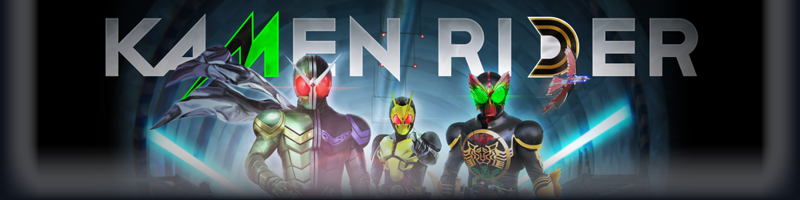

# Kamen Rider: Memory of Heroes (Android ARM64 Port, `nixport` Edition)

<p align="center">
  <strong>English</strong> | <a href="README.id.md">Bahasa Indonesia</a>
</p>

<p align="center">
  
</p>

<p align="center">
  
  
  
  
  
</p>

---

## Available Editions (PC & Android)

| Platform | Repository | Notes |
| :--- | :--- | :--- |
| **Android ARM64 (`nixport`)** | [ao-zero/Kamen-Rider-Memory-of-Heroes-Android](https://github.com/ao-zero/Kamen-Rider-Memory-of-Heroes-Android) *(This Repo)* | Android ARM64 Port (`FEXCore` + `shadPS4`, `v1.0.0`) |
| **Windows PC (x64)** | [ao-zero/Kamen-Rider-Memory-of-Heroes-PC](https://github.com/ao-zero/Kamen-Rider-Memory-of-Heroes-PC) | PC Native Edition (`v1.2.0`, 60 FPS, Clean UI) |

---

## Overview

**Kamen Rider: Memory of Heroes (Android ARM64 Port, `nixport` Edition)** is an open-source launcher and `nixport.port.v1` package for running **Kamen Rider: Memory of Heroes (`CUSA17374`)** on ARM64 Android devices using **`nixport` + `FEXCore` (x86-64 guest CPU to ARM64) + `shadPS4` Vulkan 1.3**. It ships with a **Built-in Indonesian Subtitle Patch (5,993 strings by Bakka Sub)** and a custom landscape **Touch Virtual Gamepad** layout.

Featuring the heroic trio:
- **Kamen Rider Double (W)**: Cyclone & Joker
- **Kamen Rider OOO**: TaToBa (Taka, Tora, Batta)
- **Kamen Rider Zero-One**: Rising Hopper

### Team & Partner
- **Port Lead & Developer:** **AO Zero**
- **Community Partner & Indonesian Localization:** [**Bakka Sub**](https://www.bakkasub.my.id)

---

## Key Features

- **Clean UI Launcher v1.0.0 (Dark & Light Mode):** Minimalist interface inspired by [XSEmu](https://github.com/zortos293/xsemu) built in pure Python `tkinter` (zero external dependencies). Automatically switches to fullscreen touch-adaptive scaling inside `nixport` (`FEXDROID_PRESENT`).
- **Built-in Indonesian Subtitle Patch (Bakka Sub x AO Zero):**
  - 1-click toggle for **5,993 translated strings** (`help_list`, `menu_text`, `mission_talk`, `name_text`) in `CUSA17374/Media/sharedassets0.assets`.
  - Pure-Python Unity `2017.4.40f1` `SerializedFile` patcher with automatic untouched vanilla backup stored persistently in `home/kr_moh/bin/user/vanilla_backup/`, allowing instant restore back to **Original (EN/JP)** anytime.
- **Mobile Performance Presets (`540p / 720p / 1080p` & `30 / 60 FPS`):**
  - Automatic `config.json` sync (`vblank_frequency` 60 Hz for 30 FPS Locked or 120 Hz for 60 FPS Native Unlock, `Mailbox`, `async_shader_compilation`, `FSR + RCAS`, and `pipeline_cache_enabled`).
  - Automatic input conflict protection: forces `mouse_to_joystick = none` when `FEXDROID_PRESENT` is active so virtual touch analog controls never clash with pointer events.
- **Ready-to-Play Touch Virtual Gamepad (`virtualkeys.json`):** Custom landscape touch layout tuned for Kamen Rider combat (`L1/L2`, `R1/R2`, diamond `△○×□`, Dual Analog Sticks, D-Pad, Map, Options), imported automatically by `nixport`.
- **Savegame Manager & 50 Bilingual Trophies:** Portable timestamped `.zip` save backup/restore under `home/kr_moh/` plus the full official 50-trophy PS4 catalog (English & Bahasa Indonesia).
- **Full `nixport.port.v1` Integration:** Implements `AppRun` + `entry.sh` + `entry_main.py` verbs (`launcher`, `game`, `info`, `config`, `check`) with dynamic JSON schema support.

---

## Android Device Requirements

| Component | Minimum (`540p`, `30 FPS`) | Recommended (`720p`, `60 FPS`) |
| :--- | :--- | :--- |
| **OS** | Android 11+ (ARM64 / `aarch64`) | Android 13 / 14 / 15 (ARM64) |
| **SoC / GPU** | Qualcomm Snapdragon 865 / 870 / 7+ Gen 2 / 8 Gen 1 (Adreno 650 / 7xx) | Qualcomm Snapdragon 8 Gen 2 / 8 Gen 3 / 8 Elite (Adreno 740+) |
| **Vulkan Driver** | Vulkan 1.3 via **Mesa Turnip** (configured in `nixport`) | Latest Mesa Turnip (Vulkan 1.3 / 1.4) |
| **RAM** | 8 GB | 12 GB or 16 GB |
| **Free Storage** | 15 GB (fast internal UFS storage) | 20 GB+ (UFS 3.1 / 4.0) |
| **Controls** | On-screen Touch (`virtualkeys.json`) | Bluetooth / USB-C Gamepad (DualSense, Xbox, GameSir, Backbone) |

> **GPU Note:** Older Adreno 5xx GPUs (such as Snapdragon 636) and non-Snapdragon GPUs (Mali, Xclipse, PowerVR) are not supported because `shadPS4` requires full Vulkan 1.3 extensions currently provided on Android by **Mesa Turnip** (Adreno 6xx/7xx/8xx).

---

## Installation Guide (Android)

> **Legal Notice:** This repository and its release packages do **NOT** include copyrighted PS4 game files, ROMs, or `eboot.bin`. You must supply your own legally dumped copy of *Kamen Rider: Memory of Heroes* (`CUSA17374`).

### Step 1: Install the `nixport` Host App
1. Download the latest **`nixport`** APK from [zFitness/nixport Releases](https://github.com/zFitness/nixport/releases).
2. Install the APK on your Android device and grant *All Files Access* permission so it can read your game folder on `/sdcard/`.
3. Open `nixport` and make sure the ARM64 Linux rootfs and **Mesa Turnip** Vulkan driver are installed in `nixport` settings.

### Step 2: Download & Import the Port Package
1. Download **`KamenRiderMoH.nixport.<version>.zip`** from the [Releases](https://github.com/ao-zero/Kamen-Rider-Memory-of-Heroes-Android/releases) page.
2. Open **`nixport`**, go to **Library**, and choose **Import Port package**.
3. Select the downloaded `.zip` file. `nixport` automatically reads `port.json`, extracts `KamenRiderMoH-arm64.AppImage`, and registers the `virtualkeys.json` touch layout.

### Step 3: Place Your `CUSA17374` Game Dump in Internal Storage
Copy your extracted PS4 game dump (Update `v1.01` recommended) to internal storage, for example:
```text
/storage/emulated/0/Games/CUSA17374/
├── eboot.bin                  <-- Required
├── sce_sys/
│   └── param.sfo
└── Media/
    └── sharedassets0.assets   <-- Target for Indonesian Subtitle Patch
```
> Avoid placing the dump on a slow external SD card, as Unity asset streaming will stutter.

### Step 4: Configure & Play
1. In `nixport`, tap **Kamen Rider: Memory of Heroes** and open **KR Memory of Heroes Launcher**.
2. In the **Overview** tab, tap **Change** next to *Folder* and pick `/storage/emulated/0/Games/CUSA17374`.
3. Adjust **Quick Overrides** for your device:
   - **Snapdragon 865 / 870 / 8 Gen 1:** `540p`, `30 FPS` (or `60 FPS`), FSR `On`.
   - **Snapdragon 8 Gen 2 / 8 Gen 3 / 8 Elite:** `720p`, `60 FPS`.
4. *(Optional)* To enable **Indonesian Subtitles (Bakka Sub)**: tap **Patch Indo** in the action bar (or open the **Patch Indo** tab and tap **Enable Indonesian Patch**). Wait a few seconds until all 5,993 strings are applied.
5. Tap **Play** to launch the game.

---

## Default Touch & Gamepad Controls (`virtualkeys.json`)

| Control | Screen Position (Landscape) | In-Game Action |
| :--- | :--- | :--- |
| **Left Analog Stick** | Bottom Left | Move Character |
| **D-Pad** | Mid-Bottom Left | Items / Menu Navigation / Shortcuts |
| **Right Analog Stick** | Mid-Bottom Right | 360° Camera Control |
| **`□` (Square)** | Bottom Right (Left Diamond) | Light Attack |
| **`△` (Triangle)** | Bottom Right (Top Diamond) | Heavy Attack / Form Skill |
| **`○` (Circle)** | Bottom Right (Right Diamond) | Dodge / Dash / Cancel |
| **`×` (Cross)** | Bottom Right (Bottom Diamond) | Jump / Confirm |
| **`L1`** | Top Left (Lower) | Guard / Lock-On Target |
| **`L2`** | Top Left (Upper) | Form Change (W / OOO / Zero-One) |
| **`R1`** | Top Right (Lower) | Rider Power Stance |
| **`R2`** | Top Right (Upper) | Finisher / Max Drive |
| **`MAP` (Select / Touchpad)** | Top Center Left | Map / Objectives |
| **`OPT` (Options / Start)** | Top Center Right | Pause Menu |

> You can also pair a **Bluetooth or USB-C controller** (DualShock 4, DualSense, Xbox, GameSir, Backbone) and hide the on-screen overlay from the `nixport` session menu.

---

## Project Structure

```text
Kamen-Rider-Memory-of-Heroes-Android/
├── .github/workflows/
│   └── arm64-port.yml                # GitHub Actions CI: Debian Trixie cross-build & Release publisher
├── assets/                           # App icon, banner, Bakka Sub logo, 50 trophy icons
├── launcher/
│   └── kr_android_launcher.py        # Clean UI v1.0.0 Launcher (Pure Python Tkinter, Dark/Light)
├── packaging/arm-linux/
│   ├── port.json                     # nixport.port.v1 manifest
│   ├── virtualkeys.json              # nixport.virtualkeys.v1 landscape touch layout
│   ├── AppRun                        # AppImage entrypoint
│   ├── entry.sh                      # Verb protocol handler (launcher|game|info|config|check)
│   ├── entry_main.py                 # Dynamic JSON schema/get/set contract for nixport
│   ├── build-runtime.sh              # Native ARM64 shadPS4 + FEXCore Debian Trixie builder
│   ├── ci-deps.sh                    # Ubuntu 24.04 cross-compile dependency installer
│   ├── cross-toolchain.cmake         # Clang + LLD + aarch64-linux-gnu CMake toolchain
│   ├── fetch-sysroot.py              # SHA-256 verified Debian Trixie arm64 sysroot fetcher
│   └── build.sh                      # Type-2 ARM64 AppImage & strict nixport.port.v1 bundler
├── patches/
│   └── id_patch.json                 # 5,993 Indonesian translation strings (Bakka Sub)
├── runtime/
│   └── runtime-lock.json             # Pinned open-source shadps4-arm64 + FEXCore revision
├── scripts/
│   ├── android_config.py             # Persistent $HOME/kr_moh storage, config.json & input sync
│   ├── indo_patcher.py               # Pure-Python Unity 2017.4 SerializedFile patcher
│   ├── save_manager.py               # Cross-platform CUSA17374 save backup & restore
│   ├── sfo_parser.py                 # Binary param.sfo parser
│   └── trophy_manager.py             # Official 50-trophy bilingual catalog
├── LICENSE                           # GPL-2.0-or-later
├── README.md                         # English documentation (this file)
└── README.id.md                      # Indonesian documentation (Bahasa Indonesia)
```

---

## Building from Source & CI

### Run the Launcher Locally (Windows / Linux Desktop)
```bash
git clone https://github.com/ao-zero/Kamen-Rider-Memory-of-Heroes-Android.git
cd Kamen-Rider-Memory-of-Heroes-Android
python3 launcher/kr_android_launcher.py
```

### Build the `nixport` Package on Linux (Ubuntu 24.04 + Docker)
```bash
# 1. Cross-compile native ARM64 shadPS4 + FEXCore inside Debian Trixie
bash packaging/arm-linux/build-runtime.sh

# 2. Pack Type-2 ARM64 AppImage + strict nixport.port.v1 .zip
bash packaging/arm-linux/build.sh
```
On **GitHub Actions**, push any `v*` tag (such as `v1.0.0-alpha.1` for an automatic Pre-release, or `v1.0.0` for a stable Release), or run the **ARM64 port package** workflow manually.

---

## Troubleshooting & FAQ

- **`eboot.bin` not found when picking folder:** Make sure you select the extracted `CUSA17374` folder containing `eboot.bin` and `sce_sys/` (not a raw `.pkg` file).
- **Initial stuttering during gameplay:** Normal on first visit to new areas while Vulkan shaders compile. Shaders are archived in `pipeline_cache` for smoother subsequent sessions. After updating Turnip drivers, tap **Clear cache** in **Overview**.
- **Black screen on launch:** Verify **Mesa Turnip** is active in `nixport` settings (not the stock vendor GPU driver), test with `540p` + `30 FPS`, and inspect `home/kr_moh/logs/launch.log` and `home/kr_moh/bin/user/log/shad_log.txt`.
- **Reverting to English/Japanese subtitles:** Open the **Patch Indo** tab and tap **Restore Original (EN/JP)** to restore the pristine backup of `sharedassets0.assets`.

---

## Credits & Acknowledgments

- **[AO Zero](https://github.com/ao-zero)**: Port Lead & Developer for *Kamen Rider: Memory of Heroes* (PC Native & Android ARM64 Editions).
- **[Bakka Sub](https://www.bakkasub.my.id)**: Community Partner & Indonesian Tokusatsu localization team (5,993 translated strings).
- **[zFitness/nixport](https://github.com/zFitness/nixport)** & **[zFitness/gow3_android](https://github.com/zFitness/gow3_android)**: Non-root ARM64 Android Linux host runtime, `nixport.port.v1` / `nixport.virtualkeys.v1` contracts, and port packaging reference.
- **[shadPS4](https://github.com/shadps4-emu/shadPS4)**, **[zenithblue-oss/shadps4-arm64](https://github.com/zenithblue-oss/shadps4-arm64)**, & **[FEX-Emu / FEXCore](https://github.com/FEX-Emu/FEX)**: Open-source PS4 Vulkan 1.3 emulation core and ARM64 FEXCore guest CPU backend.
- **[XSEmu](https://github.com/zortos293/xsemu)** *(by zortos293, GPL-2.0)*: Clean UI layout inspiration (hero detail view, 2x2 hairline spec grid, segmented Quick Overrides).

---

## Legal Disclaimer

- *Kamen Rider: Memory of Heroes* is a trademark and copyright of **BANDAI NAMCO Entertainment Inc.**, **ISHIMORI PRODUCTION INC.**, and **TOEI COMPANY, LTD.**
- This project is a non-commercial, fan-made launcher and compatibility utility for preservation and interoperability.
- **NO** copyrighted binaries, assets, audio, video, or ROMs are distributed in this repository. Users must own a legitimate PS4 copy and dump their own game files.
